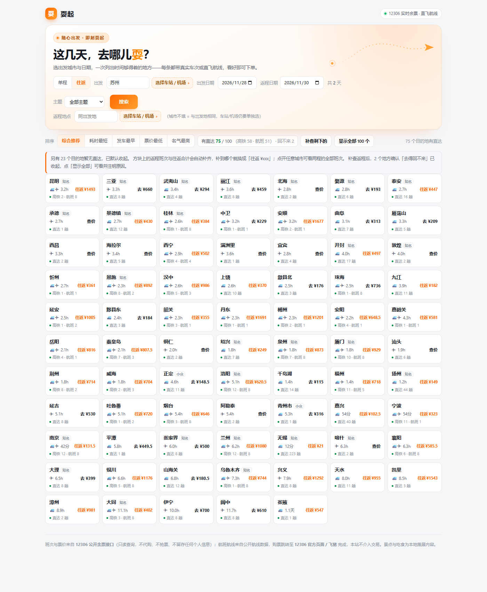

# 耍起 · 随心出发，即刻耍起

> 按「时间预算」发现目的地 —— 2026 飞猪 AI 旅行创新大赛（旅行 AI 黑客松）参赛作品 · 命题方向：**目的地探索**
> 数据源：**高铁余票走 12306 公开只读接口**，**航班航线走本地航线库**，**预订入口跳转 12306 官方页 / 飞猪**；
> 只做只读展示，不代购、不抢票、不存储任何用户身份信息

---

## 一句话

不说目的地，只说「我有几天」。

选好出发城市（并自己勾选要走哪几个车站、哪几个机场）、出发日期与天数，
系统一次列出所有「时间够得着」的地方，每条都带**真实车次或直飞航线、票价、余票**，
以及一个**明确告诉你去哪儿买**的按钮——高铁去 12306，机票去飞猪。

## 长什么样

| 首屏：只说「我有几天」 | 往返结果墙 | 展开一地的往返明细 |
|---|---|---|
|  |  |  |

截图取自在线 Demo 真实运行（非设计稿）。在线体验：<https://shuaqi.app.workbuddy.host/?sharecode=SJLVSCDTPE>

## 输入只有三件事（v1.1）

| 单程 | 往返 |
|---|---|
| 出发城市 · 出发日期 · **天数**（半天 / 1 天 / 周末 2 天 / 3 天） | 出发城市 · 出发日期 · **返程日期**（天数由两个日期算出来，不用重复选） |

- **天数只在单程时出现**：往返的行程长度本来就由返程日期决定了，再让用户选一遍「几天」是多余的。
- **返程日期只在往返时出现**；单程页面不会出现一个填了值却用不上的日期框。
- 无论单程往返，出发地与返程地都可以各自勾选**具体车站 / 机场**。

## 勾选即严格匹配

勾了苏州北，结果里就只有苏州北出来的车——不会混进苏州站、苏州新区的班次，也不会在你只勾车站时
突然冒出一堆航班。规则只有一条：

> **勾了就只出勾的；没勾的那一类就是「不要」。**

实现上有三道保险：① 车站/机场按勾选集过滤（不再回退成「该市默认站」或「全部机场」）；
② 关掉「直达太少就补查同城其他站」的兜底；③ 结果按**上车站名**再筛一遍，挡住历史缓存里的脏数据。
勾的车站确实没直达时，页面会说「确认无直达」；如果是 12306 正限流、没取到实时数据，则明确说
「这次没取到，不代表没有」——**不拿推测冒充结论**。

## 候选池 100 个，一屏 50 条

- 策展库仍是 216 个目的地，**候选池取名气最高的 100 个**（`POOL_LIMIT`，默认 100）。
  一轮全量扫描从 216 次 12306 查询降到 100 次，快一倍，也更不容易触发限流。
- 列表默认只铺**前 50 条**（按「有直达 → 推荐分 → 名气」排序），底部「再展开」看长尾，
  顶部「显示全部」回到全量——216 个候选一次铺开，没人翻得完。

## 为什么是「时间」而不是「目的地」

常规产品是「你想去哪 → 我给你查车」。
本产品把顺序反过来：**「你有多少时间 → 我告诉你该去哪」**。

- 半天 / 1 天 / 周末 2 天 / 3 天，对应不同的「理想单程耗时」，
  车程不是越短越好，而是有「甜点区」——太近没有出走感，太远全部耗在路上。
- 火车与飞机统一到「耗时」这一个量纲上混排比较。
- 216 个目的地 × 648 条策展（必看 / 必吃 / 建议天数），候选池取其中名气最高的 100 个是「为什么推荐这里」的证据链，不是装饰。

## 架构：三层数据，每层都用最合适的来源

| 层 | 来源 | 请求成本 | 作用 |
|---|---|---|---|
| **策展层** | `data/destinations.json`（本地） | **0** | 216 个目的地（池子取前 100）：名称、主题、卖点、必看 / 必吃 |
| **高铁层** | `railways.mjs` → 12306 公开余票接口 | 每个目的地 1 次（280ms 间隔） | 车次、时刻、历时、各席别票价与余票 |
| **航班骨架** | `data/air.json` 本地航线库（零网络） | **0** | 谁在飞这条航线、飞多久、多远、哪几家航司 |
| **航班实时** | `flyai.mjs` → 飞猪 flyai CLI | **按需 1 次 / 目的地** | 航班号、起降时刻、票价、飞猪下单链接 |

四层各自独立：**任何一层不可用都不会让整体功能失效**。航班骨架跑在本地，
即使完全断网、或飞猪侧风控，列表也照常出。

### 为什么航班拆成「骨架 + 实时」两段

本产品一年到头要覆盖 **282 个机场 × 6659 条境内直飞航线**。任何按调用计费的
航班 API 在这个量级上都会把「一次查完 216 个目的地」这件事变得不可接受——
要么限流掐断、要么账单失控。

所以航班层拆成两半，各答一半问题：

- **可达性事实**（有没有直飞、飞多久、多远、哪几家航司）→ 本地航线库，零成本、瞬时、永久可用；
- **交易事实**（具体哪一班、几点起飞、多少钱）→ 飞猪 flyai 实时查询。

**实时那段只在两种时机调用**：① 用户展开某一条（一次调用，缓存 30 分钟）；
② 扫描结束后给排名最前的 8 个目的地预热。**绝不做全量批量扫**——
实测并发 3 连打 87 个目的地会被飞猪风控判定为「异常访问行为」（HTTP 451），
前几条正常、后面全废，用户看到的就是「只有几个航班」。
串行 + 3 秒间隔 + 滚动窗口 12 次/60s + 单日 40 次上限才稳。

> 注意区分两层「数量」：`FLIGHT_MAX=30` 指的是**用本地航线库做骨架的候选数**，
> 一个请求都不发；真正打飞猪的是 `FLYAI_WARM`（默认 30）。把 WARM 调高不会更安全——
> 单次能过，但换个日期再扫一遍就是 60 次，直接越过当天 40 次的上限。

这样「飞机能不能到、要多久」这类**决策信息**永远秒回，而**交易信息**始终是最新的。
航线库由 `scripts/build_data.py` 从公开航线数据构建，可随时重建（重跑结果字节一致，可校验）：

```bash
# 原始数据（两份公开数据集）放在 scripts/.src/：airline_routes.json + airports.json
python scripts/build_data.py --src scripts/.src --out data
# → 端口数 4037 | 有航线机场 257 | 航线总条数 6659 | 车站城市数 432
# → data/air.json（481 KB）· data/stations.json（40 KB）
```

### 高铁为什么用 12306 而不是第三方

12306 的余票查询是**公开的只读接口**：单次 45~90ms、不需要任何 Key、没有配额。
而本产品的核心承诺是「一次把 216 个候选目的地全部查完」——只有 12306 顶得住这个量级。
购票仍然回到 **12306 官方页面**（本站不介入交易）。

### 关键设计

- **打开即出全量列表**：`GET /api/list` 只读本机缓存（内存 / 磁盘 14 天），
  零网络请求，所以首屏永远秒开、永远不空屏。缺的由 `GET /api/scan`（SSE）增量补齐。
- **自己勾选车站与机场**：苏州没有民航机场，那就按经纬度就近推荐（硕放 28km、
  嘉兴 67、虹桥 69、南通 92、常州 105、浦东 114、萧山 120），勾哪个用哪个。
  出发地和返程地各自独立勾选。
- **单程 / 往返**：往返模式下返程可单独选城市、勾车站机场、选日期，一套参数贯穿全链路。
- **只列有直达的**：216 个候选里总有一部分从出发地确实没有直达。
  默认收起（右上角显示「有直达 N / 216」），点「显示全部」可展开；
  展开时明确标注「12306 已确认无直达 · 需中转」或「无民航机场」，**而不是含糊的「未取到」**。
- **同线路存档日回退**：日期一变缓存失效会让页面看起来像坏了，所以按路线回退到最近的存档日；
  但**余票留空**，避免拿 A 日的余票冒充 B 日。
- **同城站归并**：12306 会把同一趟车按出发城市群每个乘车站各返回一行（`train_no` 相同），
  必须归并；且代表班次**取出发地本站的方案**，否则苏州出发会显示成「张家港上车」。
- **12306 速率纪律（不要调高）**：全局最小间隔 **280ms** + 并发 3 + 自适应放大 + 熔断。
  实测并发 8 猛打几分钟就会把本机 IP 打成「大部分 302」，恢复期很长。
  另有后台温和自补（间隔 1200ms、只补缺的、每 6 小时一轮），正常使用几乎不需要重新扫。
- **每条都给出可核实的推荐理由**：列表里直接写
  `单程 3.4h，往返占这趟的 23%，还剩 23.2h 留给当地 —— 正好是周末 2 天的甜点区`。
  这句话里的每个数字都出自真实班次时长与用户自己选的天数，不是「很适合你」这种空话；
  太近或太远的会如实写「太近了，同样几天可以去得更远」「路上花掉不少」。
- **新鲜度如实标注**：`实时` / `今日缓存` / `存档日（余票留空）` / `航线` 四种徽章。

## 运行

### 一键启动（推荐，走完整百炼链路）

Windows 用户直接双击 **`启动.bat`**。它按依赖顺序拉起三个服务：

| 端口 | 服务 | 作用 |
|---|---|---|
| 8099 | 飞猪 MCP 服务 | 4 个工具：机票 / 火车票 / 酒店 / 景点 |
| 8090 | 百炼高代码应用 | 意图解析 → 调 MCP → qwen 编排 → 「· 」短行 |
| 8790 | 网站主站 | 12306 实时余票 + 本地航线库 + 调百炼应用 |

浏览器打开 <http://127.0.0.1:8790>。

脚本会先清掉上次残留的端口占用，重复双击也不会冲突。
**没装 python 时会自动跳过 8090**，主站降级为「直连百炼模型 → 本地规则」，功能不残缺。

### 只跑主站

```bash
node server.mjs
```

不需要任何 Key、不依赖任何第三方账号。行程会走本地规则，其余功能完全一致。

### 看到真实机票（航班号 / 时刻 / 票价）

需要配好飞猪 [flyai CLI](https://www.npmjs.com/package/@fly-ai/flyai-cli)
的 Key（放在 `~/.flyai/config.json` 或环境变量 `FLYAI_API_KEY`）。检测到就自动启用，
检测不到就只出「能不能直飞、飞多久」的骨架，**不会报错、不影响下单跳转**：

```bash
curl http://127.0.0.1:8790/healthz
# "flyai":{"ready":true,"concurrency":1,"gapMs":3000,"dayBudget":"0/40",...}   ← 已启用
# "flyai":{"ready":false,...}                               ← 未配置，走骨架
```

> ⚠️ **不要对航班接口做全量批量扫**。实测并发 3 连打 87 个目的地会触发接口保护
> （`HTTP 451 Abnormal access behavior`），之后一段时间内该 Key 全部请求被拒；
> 高频逐条查也会触发 `HTTP 403` 同样的保护。这是**行为频率**限制，跟配额无关。
> 本项目因此只在「用户展开某条」和「预热前 8 条」时调用，串行 + 3 秒间隔 + 12 次/60s 滚动窗口 + 冷却。
> 一旦命中，`/healthz` 的 `flyai.coolingMin` 会显示剩余冷却分钟数。
>
> **保护期是账号级、24 小时的**（2026-10-21 官方答复 + 实测）：
> 单次请求频率合规并不能豁免它，命中的判定看的是窗口内的累计行为。
> 所以命中后**唯一的正确动作是停手 24 小时**——保护期内任何探测都会把 24 小时重新计时。
> 熔断状态落盘在 `data/risk-state.json`，**重启不清零**。
> 保护期内航班部分用 `data/flight-cache.json` 的历史真价顶上并标注查询时间，绝不编价。

### 三道闸门，缺一层都会在演示当天出事

只防「瞬间多快」是不够的。2026-10-21 当天累计 **52 次调用撞出 4 个 451** 就是反例：

```
① 条间隔        3s/条        —— 防连打
② 滚动窗口      12 次/60s    —— 官方配额是 20~24 次/60s，留 40% 边际
③ 单日累计      40 次/天     —— 前两层都管不住「一天打多少」
```

第三层是这次补上的。原因很具体：票价缓存按 **「出发城市 + 日期」** 分片，
换个日期就是全新的一批 key、缓存全 miss，于是每次扫描都按满额重打。
演示那天换 `10-28 / 10-25 / 10-29` 三个日期各扫一遍，单次 24 秒的温柔扫描
就这么叠成了 52 次——窗口闸门全程没报警，账号却已经进了风控。

- 日账本落盘 `data/flyai-day.json`，**重启不清零**，按北京时区跨天自动归零
- 超支后**零请求**，返回 `DAY_BUDGET`，用历史真价顶上并标注查询时间
- `FLYAI_DAY_MAX=0` 表示显式关闭（不是"零额度"）
- `/healthz` 的 `flyai.dayBudget` 显示 `已用/上限`，`dayLeft` 是剩余额度
- 离线验证：`node scripts/test-day-budget.mjs`（假 CLI，零真实请求）

首轮启动后建议跑一次温和预热，把默认日期的班次补齐（之后后台会自动维护）：

```bash
node scripts/warm-rail.mjs        # 间隔 1.3s、只补缺的、几乎不熔断
node scripts/warm-rail.mjs 1,3,7  # 顺带补「今天+1 / +3 / +7 天」
```

### 公网演示模式

```bash
set DEMO=1 && node server.mjs
```

`DEMO=1` 下**不发起任何实时请求**，只读本机 `data/rail-cache.json` 里已经抓到的真实班次。
公网 demo 就跑在这个模式上：无论部署环境能否连通 12306，页面打开都是完整的
216 条目的地列表 + 已缓存的真实车次，不会出现「一打开就空屏」。

> **已上线的公网 demo**：<https://train-ticket-finder.app.workbuddy.host/>

### 环境变量

| 变量 | 默认 | 说明 |
|---|---|---|
| `PORT` | `8790` | 监听端口 |
| `HOST` | `0.0.0.0` | 绑定地址。发布沙箱要求反代可达，故默认全网卡；本机访问 `127.0.0.1` 一样正常 |
| `DEMO` | 空 | `1` = 演示模式：不发起实时查询，只读本机已缓存的真实班次 |
| `CONCURRENCY` | `2` | 扫描并发数（12306 侧另有独立的速率纪律，见 `RAIL_MIN_GAP_MS`） |
| `SCAN_LIMIT` | `9999` | 单次扫描的目的地上限。12306 无配额，默认全量扫 |
| `RAIL_MIN_GAP_MS` | `280` | 12306 请求的最小间隔。**实测调低会触发频控，勿动** |
| `RAIL_CONCURRENCY` | `3` | 12306 并发数 |
| `RAIL_DISK_TTL_MS` | 14 天 | 磁盘缓存有效期，决定「存档日」能回退多远 |
| `RAIL_WARM_EVERY` | 6 小时 | 后台温和自补的间隔（`0` = 关闭） |
| `FLYAI_API_KEY` | 空 | 飞猪 flyai Key。留空则读 `~/.flyai/config.json`（**Key 不进项目目录**）。两者都没有就只出航班骨架 |
| `FLYAI_BIN` | 自动探测 | flyai CLI bundle 路径，默认取本机 `@fly-ai/flyai-cli/dist/flyai-bundle.cjs` |
| `FLYAI_CONCURRENCY` | `3` | 飞猪并发。2026-10-23 举办方把 AK 开到 **5 QPS** 后由 1 提到 3，实测 1.61 QPS 稳定；并发 3 偶发 429（瞬时限流，已自动重试） |
| `FLYAI_GAP_MS` | `400` | 飞猪两次调用的最小间隔。旧口径 20~24 次/60s 时是 3s；5 QPS 授权后降到 400ms（实测安全档） |
| `FLYAI_WINDOW_MAX` | `60` | 滚动窗口内最多几次调用 / 60 秒。5 QPS = 300/60s，仍留 5 倍边际 |
| `FLYAI_DAY_MAX` | `400` | **单日累计调用上限**。到顶后零请求、全走缓存真价。`0` = 不限制。一次扫描约 42 次（30 预热 + 12 热门补价），够演示 9 轮 |
| `FLYAI_WARM` | `30` | 扫描时预热前 N 个航班候选的实时票价（`0` = 不预热）。5 QPS 后 30 条约 19 秒出完 |
| `FLYAI_REFRESH` | `12` | 额外按名气补一轮热门目的地的实时票价（扫描池常只剩冷门城市，热门的价格会一直停在旧日期）。`0` = 关闭 |
| `FLYAI_TTL_MIN` | `30` | 单条航班结果缓存分钟数，决定重复展开是否再耗调用 |
| `AFFILIATE_QUERY` | 空 | **CPS 推广位**。填 `utm_source=xxx&cid=yyy` 后，所有飞猪跳转链接自动带上该参数，成交可分佣。留空则链接原样输出 |
| `BAILIAN` | 空 | `1` = 启用阿里云百炼做行程润色。端点与模型名自动补全，Key 从 `~/.bailian/config.json` 读 |
| `DASHSCOPE_API_KEY` | 空 | 百炼 Key。设了它等同于设 `BAILIAN=1`（该 Key 也可放 `~/.bailian/config.json`） |
| `LLM_BASE` / `LLM_API_KEY` / `LLM_MODEL` | 空 | **可选**的其他 OpenAI 兼容端点。三者齐全才启用，**只**用于给行程块润色措辞。任何失败都静默退回本地规则 |
| `~/.llm/config.json` | 不存在 | **备用模型**（`{base, api_key, model, label}`）。百炼欠费 / 超时 / 报错时自动顶上，`engine` 会如实写是谁润色的。Key 不进项目目录 |
| `NO_OPEN` | 空 | `1` = 启动后不自动打开浏览器（服务器 / 沙箱环境用） |

## AI 能力放在哪儿

界面上**没有任何抽象输入框**——用户不需要描述「想要什么感觉」。
所有输入都是表单里确定的字段（出发地 / 返程地 / 日期 / 天数 / 主题 / 勾选的车站机场）。

### 一、意图理解：本地规则（零配额、零外部依赖）

`parseIntent` + `localSemantic`：按名称、别名、主题词加权计数，把「想找安静能泡温泉的小城」
映射到目的地池上的排序权重。抽的是天数 / 主题 / 小众偏好这类**确定性字段**，
规则做得好，且带来两个实打实的好处：

1. **零配额、零外部依赖**——不会因为第三方额度耗尽而整层静默降级；
2. **零网络往返**——不拖慢主流程。

### 二、行程安排：本地规则生成（可选大模型润色）

`GET /api/plan` 的输入全部是**事实**，输出是一份可直接照做的安排：

| 输入（全是事实） | 输出 |
|---|---|
| 该目的地当天真实的火车 / 航班号与时刻 | 3 条带时间点的具体安排 |
| 当地策展素材（必看 / 必吃） | 转成有先后顺序的行动，不原样复述 |
| 用户选的出发日期与天数 | 决定安排几天、几点该在做什么 |

界面表现：展开任意一条目的地 → 「这几天怎么玩」→ 三行 `去` / `玩` / `住`，
每行右边挂一个对应的飞猪深链（买机票 / 看门票 / 找酒店）。

因为**输入是事实、输出是安排**，内容里每个数字都有出处：

- 「怎么去」直接取真实车次或航线，没有就如实说需要中转，**绝不编造时刻**；
- 「玩什么」来自目的地池里的本地策展素材；
- 「住哪儿」按目的地的主题标签给区域建议（老城 / 地铁沿线 / 景区门口），而不是编酒店名。

**三层降级**（网页永不空白）：

```
① 百炼高代码应用 bailian-app   ：调飞猪 MCP 拿真实航班/酒店/景点 → qwen 编排
        ↓ 应用未启动 / 超时 / 报错
② 本地直连百炼模型             ：qwen-plus 润色本地已核实要点
        ↓ 模型欠费 / 超时 / 报错
③ 本地规则生成                 ：真实班次 + 本地策展，措辞朴素但事实不缺
```

> 另有一条**备用端点**（`~/.llm/config.json`）：② 失败时自动切过去，避免欠费就只能看模板措辞。
> 它不参与「必须用百炼」的赛事链路，只是工程兜底；`engine` 字段会如实写是谁润色的。

行程卡底部会如实标注当前由哪一层生成（`由 百炼应用 生成` / `由 百炼模型 生成` / 无标注=本地规则）。
模型连续失败 2 次会自动熔断 10 分钟，避免每个目的地都白等一次超时。

```bash
# ★ 一键启动（含百炼应用 + 飞猪 MCP）
启动.bat

# ★ 只接百炼模型（不跑应用层）
set BAILIAN=1 && node server.mjs
# 验证：curl http://127.0.0.1:8790/healthz    → "llm":"qwen-plus"

# ★ 接百炼高代码应用（应用层）
set BAILIAN_APP_URL=https://你的应用地址
node server.mjs
# 验证：curl http://127.0.0.1:8790/healthz    → "bailian_app":"https://..."

# 接任意其它 OpenAI 兼容端点（三件齐全才启用）
set LLM_BASE=https://your-endpoint/v1
set LLM_API_KEY=sk-xxxxxxxx
set LLM_MODEL=qwen-plus
node server.mjs
```

> **默认关闭是刻意的**：本项目不会因为本机残留了某个旧 Key 就静默启用外部模型。
> 想用就显式打开 `BAILIAN=1`，不用就什么都不用管。
>
> **模型欠费时怎么办**：百炼返回 `Arrearage` 时三家都不能用，但第 ③ 层照常工作，
> 网页功能完整。欠费属于账户状态问题，开免费额度开关无效——需去阿里云「费用与成本」结清账单。

## 接口

| 路径 | 说明 |
|---|---|
| `GET /api/places?city=苏州` | 该城市的**车站清单 + 机场清单**（自有 / 邻近，带距离 km），供前端勾选。不带 `city` 时返回全部 491 个城市的可用性索引 |
| `GET /api/list?from=&date=&days=&tags=&transport=&tripType=&backCity=&backDate=` | **全量列表（零网络）**：216 个目的地，打开即出。`covered` 标记哪些已有班次；`slim=1` 只回元信息 |
| `GET /api/live?dest=&from=&date=&days=&transport=` | **单点补查**：只查一个目的地，成功后自动沉淀进缓存 |
| `GET /api/plan?dest=&from=&date=&days=&transport=` | **「这几天怎么玩」**：本地规则生成，`source:'local'`。返回 `lines:[{k,t,url}]`（去 / 玩 / 住） |
| `GET /api/dest?name=&days=` | 某目的地的**玩什么 / 住哪儿**：本地策展 + 飞猪酒店、门票深链 |
| `GET /api/scan?...` | **SSE** 批量扫描流：`progress` / `card` … → `done` |
| `GET /api/pool` | 目的地池与主题标签统计 |
| `GET /healthz` | 健康检查（含 12306 缓存统计、航线库统计、LLM 状态） |

页面深链：`/?go=1&from=苏州&days=2&transport=flight`
（`go=1` 自动执行搜索；`transport` = `all` / `train` / `flight`）

## 购票入口：一眼看出「去哪儿买」

这是本产品最刻意的一条设计——**不能让用户点进去才发现走错了平台**。

| 交通方式 | 按钮文案 | 跳转目标 |
|---|---|---|
| 🚄 高铁 | **去 12306 买高铁票** | `kyfw.12306.cn/otn/leftTicket/init`（带出发站 / 到达站电报码与日期） |
| ✈ 航班 | **去飞猪买机票** | `sjipiao.fliggy.com/flight_search_result.htm`（带出发城市 / 到达城市 / 日期） |
| 🏨 酒店 | 找酒店 | `hotel.fliggy.com/hotel_list.htm`（带城市与入住 / 离店日期） |
| 🎫 门票 | 看门票 | 飞猪搜索「城市 + 景点门票」 |

主按钮按最佳班次给出去处，每一条班次行右侧另有自己的按钮，
所以「这趟高铁买 12306、那趟飞机买飞猪」不会混。

> 合规说明：本站只做**只读展示**，不代购、不抢票、不留存任何个人信息。
> 班次与票价来自 12306 公开余票接口；航班航线来自公开航线数据；
> 购票与预订均在 12306 官方页面 / 飞猪 完成，本站不介入交易。

## 文件

```
flytrip-finder/
├─ server.mjs              零依赖 Node 服务（路由 / 本地行程生成 / SSE / 三段式降级 / 跳转链接）
├─ railways.mjs            12306 余票查询层（限速 · 熔断 · 同城站归并 · 磁盘缓存）
├─ airlib.mjs              本地航线库查询层（城市 → 机场 → 直飞航线）
├─ flyai.mjs               飞猪实时航班层（并发闸 · 间隔 · 缓存 · 风控冷却 · 无 Key 体验通道）
├─ planfmt.mjs             行程文案确定性整形（模型写成一整段也会被拆成「· 」短行）
├─ mcp-flyai.mjs           飞猪 MCP 服务（4 个工具，stdio / HTTP 双模，供百炼挂载）
├─ bailian-app/            百炼高代码应用（赛事「必须用百炼」的落点）
│  ├─ main.py              平台入口：GET /health、POST /process、GET /plan（FastAPI）
│  ├─ server_stdlib.py     同协议的纯标准库版，本地零依赖即可跑通
│  ├─ core.py              业务核心：意图解析 → 调 MCP → qwen 编排 → 短行
│  ├─ requirements.txt     依赖锁版本
│  ├─ pyproject.toml       打包 .whl
│  └─ README.md            本地跑通 + 部署命令
├─ 提交说明_七栏.md           按官方提交模板七栏写好的作品说明（可直接贴 Issue）
├─ scripts/build_data.py   由公开航线数据构建 data/air.json 与 data/stations.json
├─ scripts/warm-rail.mjs   温和预热（把默认日期的班次补齐）
├─ scripts/test-keypool.mjs 离线验证 Key 池 / 熔断 / 频率闸门（假 CLI，零真实请求）
├─ scripts/test-day-budget.mjs 离线验证单日预算闸门（到顶零请求 · 落盘 · 跨天清零）
├─ public/index.html       单页前端（单程/往返 · 车站机场勾选 · 全量列表 · 逐条展开）
├─ data/destinations.json  216 个目的地 × 主题标签 × 策展内容
├─ data/air.json           282 个机场 · 6659 条境内直飞航线 · 255 个城市
├─ data/stations.json      3404 个车站归并为 432 个城市（站名 → 电报码）
├─ data/rail-cache.json    12306 查询缓存（越用越全，演示模式的数据来源）
├─ 启动.bat                Windows 一键启动（MCP → 百炼应用 → 主站，三段串起来）
├─ 效果预览*.png            页面截图
└─ 参赛策略与商业价值保留.html   参赛策略 / 得奖概率 / 商业安排
```

## 与前作的关系

本项目的形态来自作者上一个作品「火车票检索」（`../train-blindbox/`）：
**一屏全列 + 自由排序 + 展开看全部班次**是那个版本最受好评的交互。

这一版保留交互形态，把数据源做成「**能自己撑住的本地资产 + 只读公开接口**」，
于是不再依赖任何一家的配额与在线状态：断网也能打开，接口挂了也能用。

---

**数据来源声明**：高铁班次与票价来自 12306 公开余票接口（只读查询）；
航班航线来自公开航线数据，由本项目离线构建成本地航线库；
酒店 / 门票 / 机票的实时价格与下单在飞猪完成，本项目仅提供跳转，不采集、不存储、不转发任何第三方数据。
