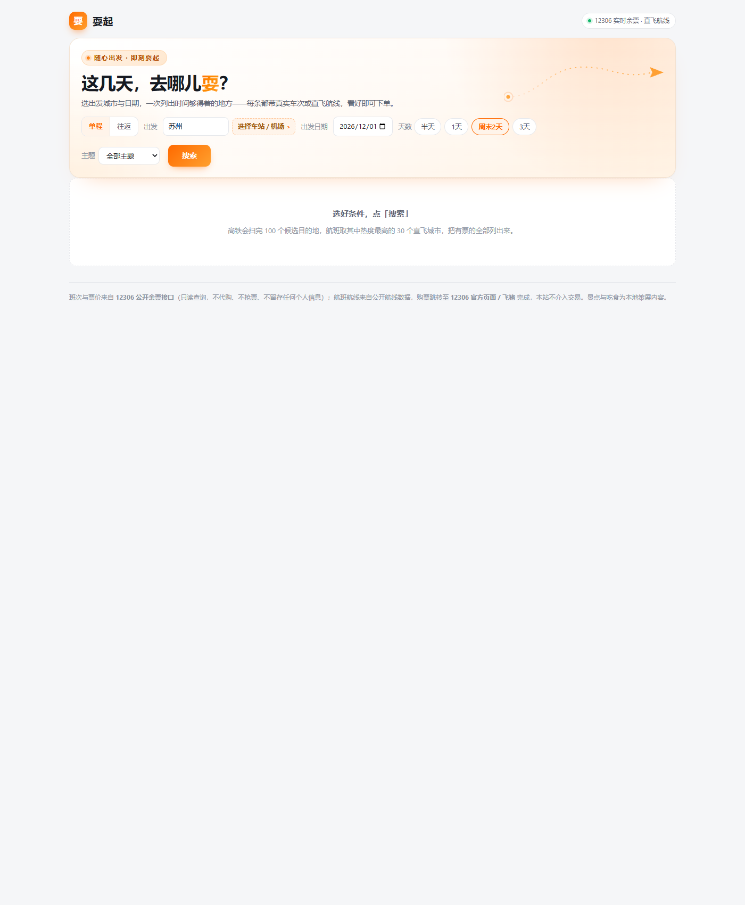
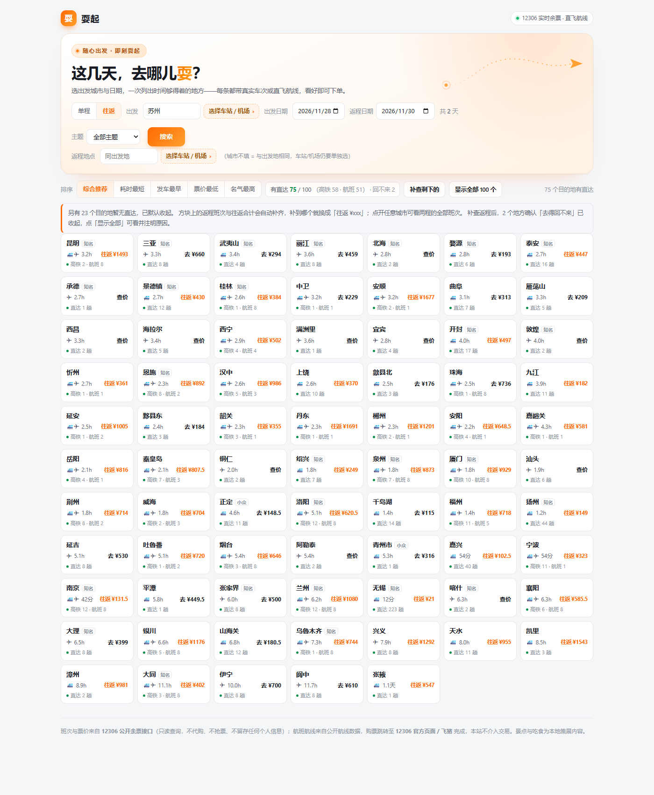
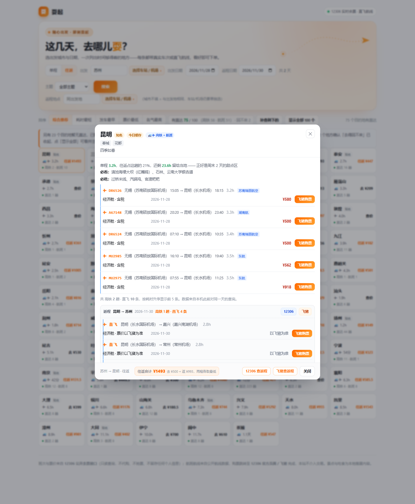

# 【2026飞猪AI旅行创新大赛】耍起


## 参赛项目名称

**耍起** · 随心出发，即刻耍起

副标题：不给目的地，只给「我哪天走、有几天」，一次列出所有时间够得着的地方，每条都带真实车次 / 直飞航线、票价与余票。

命题方向：预设方向「目的地探索」。

## 团队 / 作者与奖品领取人

- 团队名称：耍起（个人独立开发）
- 主要提交人 GitHub ID（仅 1 位，必填）：`1JacobHE`
- 其他成员：无

## 旅行场景与目标用户

**场景：出发前的「去哪儿」决策**，不是到了地方之后的行程编排。

- 目标用户：长三角、珠三角这类高铁密集城市群里，周末或三天小长假想出门、但还没想好去哪儿的年轻人与学生、双休上班族。
- 真实痛点：在苏州这样的枢纽城市，两小时高铁能到几十个城市，选项多到无法比较。搜「周末去哪玩」得到的是一堆攻略，没有人回答「**以我的出发地和这几天假，到底哪些地方来得及去、多少钱、还有没有票**」。
- 所以产品把入口倒过来：不填目的地，只填「出发城市 + 出发日期 + 天数（或返程日期）」，系统把 100 个候选目的地全部按「最快多久到」算一遍——能去的排前面，去不了的明说为什么去不了（12306 确认无直达 / 当地没有民航机场 / 按你勾的站这一程回不来）。

## 我做了什么

**一句话：把「能去哪儿」变成一次可计算、可下单的查询，而不是一场攻略搜索。**

1. **反过来的搜索入口**
   - 单程：出发城市 · 出发日期 · 天数（半天 / 1 天 / 周末 2 天 / 3 天）。
   - 往返：出发城市 · 出发日期 · **返程日期**（天数由两个日期算出来，不用重复选）。
   - 打开页面直接出全量候选墙（读本地缓存，零网络请求），不空屏。

2. **双通道真实数据，不编价**
   - 高铁：12306 公开查询接口拿**实时余票**（车次、时刻、历时、席别、票价、余票），购票跳 12306。
   - 航班：本地 6659 条直飞航线库（可达性、飞行时长、航司）+ 飞猪 flyai 实时票价（航班号、起降时刻、含税价、下单链接），购票跳飞猪。
   - 每条结果标注数据来源与新鲜度：`实时` / `今日缓存` / `存档（时刻表稳定，余票以当日为准）` / `查于 11-24 20:38`。**宁可写「查价」或「以飞猪为准」，也不猜一个价格。**

3. **往返是真查两程，而且不用你点开**
   - 展开任意一条，去程与返程各自按勾选的站/机场严格过滤，两程票钱直接给出合计（例：泰安往返合计 ¥447，由两程各自最低价相加），两个「去 12306 买票」按钮各管一程。
   - **不点开也会自动补齐**：搜索结束后前端调度器不占扫描通道，按 3 路并发逐条补返程，补到哪条哪条就从「去 ¥」变成「往返 ¥」，右上角实时显示「返程补查中 34/77」，还可点「补查剩下的」手动催。实测 75 个可达目的地约 2–3 分钟全部转成往返价。

4. **勾了就必须是勾的那个（严格匹配）**
   - 苏州没有民航机场，就按经纬度就近推荐（硕放 28km、虹桥 69km、浦东 114km…），勾哪个用哪个；只勾车站就不出航班。
   - 三道保险：按勾选集过滤 → 关掉「同城站补查」兜底 → 结果按**上车站名 / 到达站名**再筛一遍（挡住历史缓存里的串站脏数据）。
   - 「12306 确认没有直达」和「这次没取到」严格分开说，不替 12306 下结论。

5. **搜索可以被叫停**
   - 100 个目的地逐个查 12306 要几十秒，搜索期间按钮变成「停止搜索」，点了服务端真的收手（job 中止），已取到的结果全部保留，改完条件直接再搜。

6. **每一步都能解释**
   - 每个方块一句可核实的话：`单程 2.7h，往返占这趟的 18%，还剩 24.6h 留给当地 —— 正好是周末 2 天的甜点区`。数字全部来自真实班次时长与用户自己选的天数，不是「很适合你」。
   - 详情页给「必看 / 必吃 / 住哪儿」，票、酒店、门票各用各的正主。

## 百炼使用说明（必填）

- **百炼能力 / 模型**：阿里云百炼 `qwen-plus`（OpenAI 兼容端点 `https://dashscope.aliyuncs.com/compatible-mode/v1`）；另附一个百炼「高代码应用」（`bailian-app/`，`/process` 接口，输入行程约束、输出结构化 plan）。
- **调用方式**：百炼 API（OpenAI 兼容协议 `/chat/completions`）+ 自建高代码应用 `/process`。Key 从环境变量 `DASHSCOPE_API_KEY` 或 `~/.bailian/config.json` 读取，**不写进仓库、不写进前端**。
- **链路位置：运行时链路**。用户展开任意目的地 → 点「这几天怎么玩」→ 服务端把这一程的真实车次/航班号、时刻、票价、余票填进 prompt 发给百炼 → 模型回三行安排。
  - 输入（全是事实，不含抽象描述）：出发地、目的地、日期、天数、出行方式、引擎查到的候选班次（车次号/航班号、时刻、历时、票价、余票）、当地策展素材（必看 / 必吃）。
  - 输出：① 去 / 玩 / 住 三行行程骨架；② 每行对应的跳转目标（12306 / 飞猪门票 / 飞猪酒店）。
  - 约束：模型只负责**组织语言与取舍建议**，票价、时刻、余票一律以引擎数据注入，不允许模型自己编数字。
- **降级链（三层，页面永不白屏）**：百炼高代码应用 `/process` → 直连百炼 `qwen-plus` → 本地规则模板。任一层失败/超时自动落到下一层，界面**如实标注当前由哪一层生成**（`由 qwen-plus 生成` / `由本地规则生成`），不假装用了模型。
- **Skill 名称**：`flyai`（机票、酒店、景点搜索与预订链接；本项目通过 `@fly-ai/flyai-cli` 调用）。
- **其他工具 / 技术栈**：Node.js（原生 `http` + SSE 边扫边出，零框架零数据库）、12306 公开只读余票接口、本地航线库（6659 条直飞）、单文件服务端 + 单页前端（无构建步骤）。

> 体验条件：线上 demo 的百炼 Key 由开发者注入到运行环境（`DASHSCOPE_API_KEY` / 服务端配置文件），**不进仓库、不下发前端**。评委展开任意目的地即可看到 `由 qwen-plus 生成` 的结果；若某次调用超时或额度异常，会自动落到本地规则并在界面如实标注来源。

## 效果展示

以下截图均为 **2026-11-24 在线 Demo 真实运行**时截取（非设计稿）。

**首屏 —— 只填出发城市、日期、天数**



**往返结果墙 —— 方块上直接是「往返 ¥xxx」**



**展开一地 —— 去程 / 返程班次与往返合计**



| 图 | 说明 |
|---|---|
| 首屏 | 出发城市 / 出发日期 / 天数（或返程日期）与出行方式，一行搜完 |
| 往返墙 | 100 个候选里 75 个有直达（高铁 58 · 航班 51），方块上直接是「往返 ¥xxx」，未补到的写「去 ¥xxx」并继续补 |
| 展开详情 | 泰安：去程 5 班（G1230 苏州北 14:31 → 泰安 17:10，二等 ¥387）+ 返程 2 班（G739 泰安 16:11 → 苏州北 19:26，二等 ¥409）+ **往返合计 ¥447**（取两程最低价） |

实测数字（同一次会话）：
- 高铁：苏州 → 无锡 G7570，20:23 → 20:33，二等座 **¥11 / 一等 ¥19**，余票「有」，来源实时。
- 航班：苏州（硕放）→ 三亚 MU2673，09:50 → 13:10，经济舱 **¥1358**，`source=flyai`。
- 往返墙：75 个可达目的地（高铁 58 · 航班 51）在 2–3 分钟内逐个从「去 ¥」变成「往返 ¥」。

## 项目链接与复现方式

- **在线 Demo（免登录）**：https://shuaqi.app.workbuddy.host/?sharecode=SJLVSCDTPE
  - ⚠️ **必须带 `?sharecode=SJLVSCDTPE`**，裸域名会被托管网关拦成 403「链接不完整」。
  - 首次打开若遇到容器冷启动，页面会提示「服务可能正在启动」，30 秒后刷新即可（前端已做 30s × 4 次重试）。
  - 打开页面 0 外部请求（全量列表读缓存）；点「搜索」才会去查 12306，展开某条时按需查飞猪。
- **GitHub 仓库**：https://github.com/1JacobHE/shuaqi
- **怎么体验（30 秒）**：
  1. 打开链接，出发城市保持「苏州」，出发日期选今天之后、15 天内（12306 预售期）的任意一天，点「搜索」；
  2. 看方块墙：能去的直接写「¥xxx」或往返「往返 ¥xxx」，去不了的写「需中转 / 无民航机场」；
  3. 点「往返」并填返程日期，方块会随补查逐条变成往返合计；点任意方块展开看两程班次与购票入口；
  4. 点「选择车站 / 机场」可只勾某几个站（例如只勾苏州园区、返程只勾昆山南），结果里就只出现这两个站的车。
- **本地复现**：
  ```bash
  git clone <仓库地址> && cd shuaqi
  npm i @fly-ai/flyai-cli          # 机票实时价；不装则自动降级为本地航线库
  export FLYAI_API_KEYS=<你的飞猪 AK>      # 可选
  export DASHSCOPE_API_KEY=<你的百炼 Key>  # 可选，不填则行程文案用本地规则
  node server.mjs                  # 打开 http://127.0.0.1:8790
  ```
  无任何外部 Key 也能跑：高铁走 12306 公开接口，航班走本地 6659 条直飞航线库，只是票价会显示「查价 / 以飞猪为准」。

## 踩坑记录（可选）

1. **「只留 30 个航班城市」也会触发接口保护** —— 这个限制看的是**单日累计**，不是单次频率。真凶是「换一个日期 → 缓存全 miss → 一天累计请求量远超日配额」。最后加了第三道闸：单日累计预算（先记账再发请求），到顶就零请求、全走缓存真价并标注查询时间。
2. **单通道被限拖死整个池子** —— 原来是「命中 451 → 全池冷却 24h」。改成**按 Key 独立记录冷却**，并且命中后改用另一条通道继续查完这一条，不再让受限的那条拖死可用的那条。
3. **缓存键对了，数据还是串的** —— `苏州北 → 扬州` 这个键下存着苏州站和张家港的车次（历史「同城补查」污染）。只靠「查对电报码」挡不住，最后按**上车站名**再筛一遍才干净。
4. **「没查到」被写成「没有」** —— 12306 限流时返回空，前端却显示「确认无直达」，等于替 12306 下结论。现在空结果分两种：实时查过才算结论，没查到就写「不代表没有」。
5. **往返补查和扫描抢同一个闸** —— 补查在首屏渲染时立刻启动，和全量扫描同时压 12306，返程全部被打成空结果、被判定「死了」不再重试，表现成「点开才有往返价」。改成扫描期间只放 1 路、扫描结束升 3 路，失败最多 4 轮、轮间 3 秒，问题才消失。
6. **同一个城市的 3 个站被查了 6 次** —— 12306 站码是**城市级**的（苏州/苏州北/苏州园区返回同一批车），按勾选站各查一次等于白打 3 倍请求。改成城市主站码查 1 次拿全集，严格/放宽全在本地过滤，单条返程查询从 15–20 秒降到 4.7 秒。
7. **部署后机票价全没了** —— flyai CLI 路径写死成本机 Windows 绝对路径，云上 Linux 沙箱里不存在且**不报错**，只会静默降级成缓存价；改成按「项目依赖 → 上级依赖 → PATH」依次查找。

## 与评审维度的对应

- **创新性（40%）**：把「去哪儿」的搜索入口从目的地倒成**时间预算**，用时间做唯一量纲把高铁与航班混排在同一张榜上；不点开也能把往返补全，决策信息（能不能去、多久回）秒回，交易信息（哪班、多少钱）始终最新。
- **完整度（30%）**：选条件 → 全量扫描（可中止）→ 往返补查 → 展开看两程班次 → 跳 12306 / 飞猪下单，全链路在线可跑；12306 与 flyai 都是真实接口，票价与余票可逐条核对；四层数据（策展 / 高铁 / 航线骨架 / 实时价）任一层挂了都不空屏。
- **市场前景（30%）**：指向周末短途这一高频需求，用户不需要先有目的地；获客即入口，成交走 12306 / 飞猪官方链路，开发者侧可复用飞猪推广者计划；扩展方向是酒店与门票的「一并给出」、以及把时间预算模型开放成 API。
